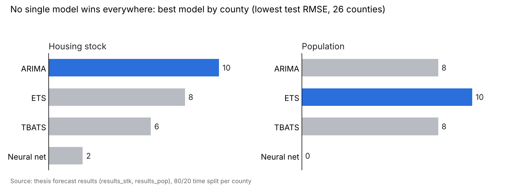

# County-Level Forecasts: Income, Population and Housing Stock in Ireland

**R · tidymodels · modeltime (ARIMA, ETS, TBATS, neural-network autoregression)**

Census data only arrives every few years, but my house-price model needed yearly county figures up to 2025. This project fills the gaps between censuses and forecasts beyond the last one, choosing the best model separately for each of Ireland's 26 counties.

## Business question

What were each county's median income, population and housing stock in every year from 2010 to 2025, when official figures exist only for census years?

## Approach

1. **Interpolate** between census years (linear) to get a yearly series per county.
2. **Rebuild housing stock** year by year: start from the 2016 and 2022 census counts and add or subtract new-house registrations going forwards and backwards.
3. **Forecast** the years after the last census with four models per county, tested on the last 20% of each county's series:
    - ARIMA
    - Exponential smoothing (ETS)
    - TBATS
    - Neural-network autoregression (NNETAR)
4. **Pick the best model per county** (lowest test RMSE), refit it on all history, and forecast.
5. **Join** the estimates to each property sale by county and year, for use in the [house prices and crime model](https://github.com/Ayoola-droid/irish-house-prices-crime).

## Results

**No single model was best everywhere, so choosing per county paid off.** Across 26 counties, picking each county's best model gave **21% lower total error** for housing stock than using ARIMA everywhere (the best single model), and **28% lower** for population than using ETS everywhere.



| Series | ARIMA | ETS | TBATS | Neural net |
| --- | --- | --- | --- | --- |
| Housing stock | **10** | 8 | 6 | 2 |
| Population | 8 | **10** | 8 | 0 |

- **Classical models beat the neural network.** It won only 2 of 52 county comparisons; with roughly a dozen yearly points per county there is too little data for it to learn from.
- **Big, steadily growing counties favoured ARIMA** for housing stock (Dublin, Cork, Kildare, Meath, Galway).
- Full per-county results, including how far ahead the winner was: [`results/best_model_by_county.csv`](results/best_model_by_county.csv).

The income forecasts use the same method; their accuracy table was not saved from the original run.

## Files

```
results/best_model_by_county.csv   # winning model and test RMSE per county
images/best_model_by_county.png
R/
├── 00_setup.R
├── 01_median_income.R
├── 02_housing_stock.R
└── 03_population.R
data/
├── median income.csv, median income 2010.csv   # CSO
├── population at census.csv                     # CSO F1001
├── housing stock.csv                            # CSO F2020
├── new house reg.csv, new house reg2.csv        # CSO HSQ10
└── county_size.csv
```

All input data is included, so these scripts can be run on their own (the final join step needs the property data from the main project).

## Skills demonstrated

Time-series forecasting · Model comparison and selection · Interpolation · Working with official statistics (CSO) · R / tidymodels

## Author

Ayoola Fadare · MSc Business Analytics (2025) · [LinkedIn](https://www.linkedin.com/in/ayoola-fadare-78916b107)